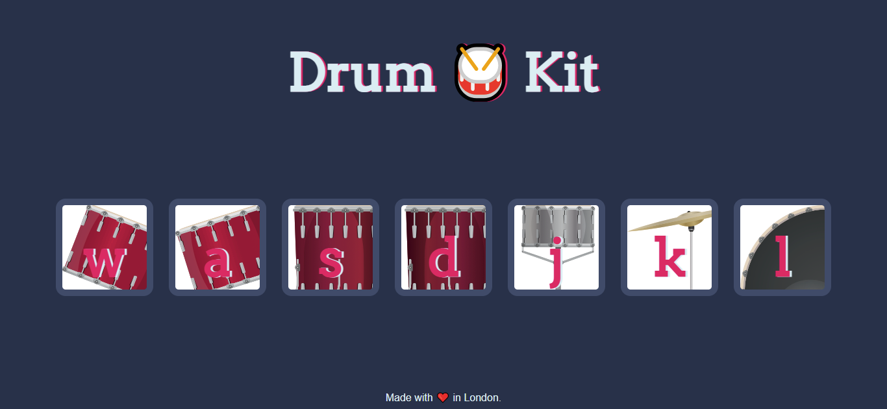

# Interactive Drum Kit 🥁

An interactive web-based Drum Kit built using HTML, CSS, and Vanilla JavaScript. This project allows users to play various drum sounds either by clicking the drum icons on the screen or by pressing the corresponding keys on their keyboard.

## 📸 Preview

Here is what the interface looks like when you open the game:

## ✨ Features

* **Mouse & Keyboard Support:** Play sounds by clicking the buttons or pressing the `w`, `a`, `s`, `d`, `j`, `k`, and `l` keys.
* **Audio Integration:** Uses JavaScript to trigger high-quality HTML5 audio elements.
* **Button Animations:** Visual feedback is provided through CSS animations whenever a drum is played.
* **Responsive Design:** Clean, centered UI that works well across different screen sizes.

## 🎵 Try These Beats!

Test out the drum kit with these simple sequences:

* **The Basic Rock Beat:** `k` - `w` - `k` - `s`
* **Fast Roll:** `w` `w` `a` `a` `s` `s` `d` `d`
* **Dance Groove:** `l` - `w` - `l` - `s` - `j`

## 🛠️ Technologies Used

* **HTML5:** Semantic structure and audio element embedding.
* **CSS3:** Custom styling, flexbox layout, and button press animations.
* **JavaScript (ES6):** Event listeners for both 'click' and 'keydown' events, DOM manipulation, and audio playback handling.

2. Navigate to the project directory.
3. Open the `index.html` file in any modern web browser.
4. Start playing the drums!

## 🤝 Let's Connect

* 💼 **LinkedIn:** [Connect with me on LinkedIn](https://www.linkedin.com/in/muhammad-waqas-siddique-9538213b7)
* 🐱 **GitHub:** [Follow my projects](https://github.com/battleshopventureswaqas-blip)

---

*Made with ❤️*
